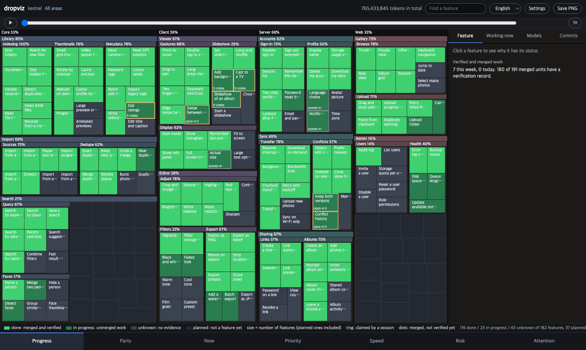
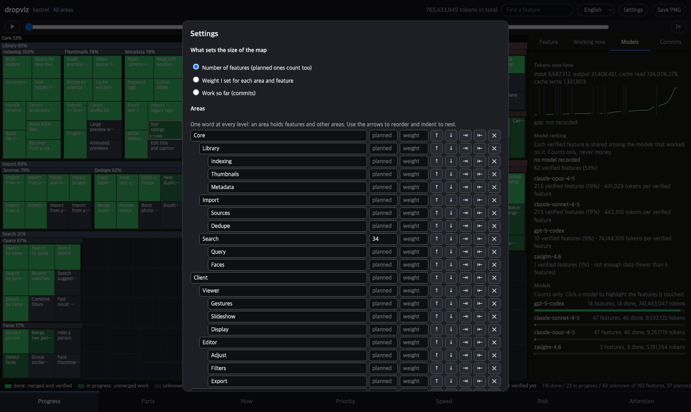
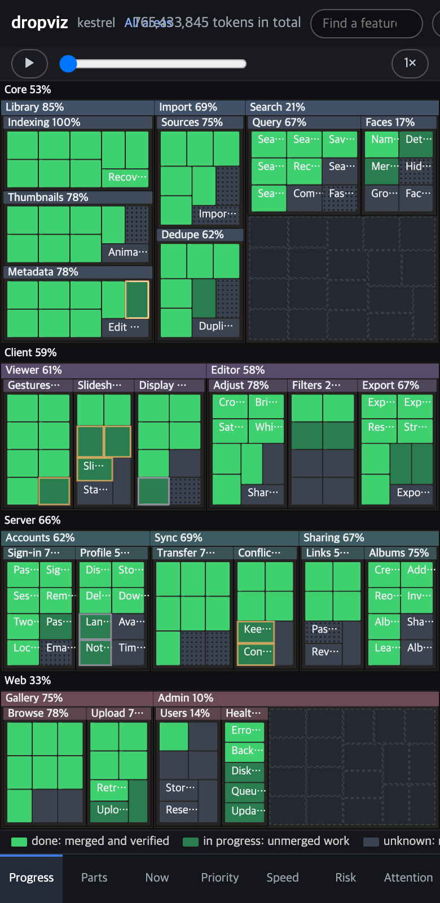

<h1 align="center"><picture><source media="(prefers-color-scheme: light)" srcset="docs/brand/logo-light.svg"></picture></h1>

**See what your AI coding agents actually finished: verified, merged, per feature.**



One tile per feature, grouped into areas (areas can hold areas), coloured by what git can prove. Nothing leaves your machine.
Real-world case: [nanumos.com](https://nanumos.com)


## 5-minute start

**Ask your AI assistant: "install dropviz for this repo and connect it."** It can do it all by itself with the commands below
(the exact steps for assistants are in [INSTALL-FOR-AGENTS.md](INSTALL-FOR-AGENTS.md)).

Needs Python 3.10+ and git. No other dependencies (standard library only).

```
pipx install git+https://github.com/zeussoftware-kr/dropviz.git    # or: python3 -m pip install --user git+https://github.com/zeussoftware-kr/dropviz.git
dropviz --version                    # prints dropviz 0.1.0 or newer
dropviz connect                      # registers dropviz as an MCP server in the AI tools found here (backs up their config; --remove undoes it)
dropviz /path/to/your/repo           # one command: reads the repo, drafts areas from the folders, opens the map at http://127.0.0.1:8765/
dropviz https://github.com/<owner>/<repo>   # a public repo: history only (no files), kept in a cache folder
```

That is the whole first run. It never changes your repo: the draft lives in the git-ignored `.dropviz/` folder.
Nothing to set up, no AI tool needed (without one it is simply the history map of your repo). If the `dropviz` command is not found,
use `python3 -m dropviz ...` instead.

Try DropViz before pointing it at your own repo, with the invented example project (about 180 features, 450 commits, AI branches):

```
python3 examples/make_demo_repo.py /tmp/kestrel
dropviz /tmp/kestrel
```

When you like it, give the map your own shape: open **Settings** on the page (or run `dropviz init` to write a
`dropviz.yaml` draft; it asks one question, "What are you building?"). The old file is always kept as a backup.

## What you see

- **Area / Feature / Card.** Three words, top to bottom. An **area** is a block of the map and can hold features and
  other areas (the breadcrumb shows the depth, for example `Core > Library > Thumbnails`). A **feature** is one tile.
  A **card** is a piece of work on a feature; cards are listed when you open a feature (who did it, which model, state).
- **Zoom** into any area and back (click its title, `Esc` goes up). Search box, legend, works on a phone.
- **Seven views** of the same map (bottom bar): **Progress** (done share), **Parts** (what is where), **Now** (what is being worked on),
  **Priority** (your weights), **Speed** (verified work per week), **Risk** (red CI, idle branches and claims, merges nobody verified),
  **Attention** (most touched; counted on this computer only). Every tile keeps a stripe in its real status colour in every view.
- **What sets the size**, your choice in Settings: number of features (planned ones included, so the whole map is the whole plan),
  a weight you give each area, or work so far (commits). The size rule never changes a status.
- **Planned** counts: say an area will end up with about 40 features and the missing ones show as grey "planned" placeholders. They are counted apart and are never "done".
- **Replay** (the play button): the history replays day by day, tiles lighting up in order, with a scrubber and 1x / 4x speed.
  `dropviz timelapse --out demo.gif` (or `.mp4`) renders it to a file; `--out map.png` saves the current map. Needs a headless browser (Playwright or Chrome) and ffmpeg for GIF/MP4. Files stay local.
- **Who built it:** human or AI tool (from `Co-Authored-By` trailers), the exact **model** when local transcripts exist
  (Claude Code, Codex, OpenCode records; counts only), a model filter on the map, and a **model ranking** panel
  (verified features per model, tokens per verified feature; counts only, with "not enough data" under 5 features).
  A model that cannot be determined is shown as "unknown model", never guessed.
- **Working now:** which tool and model is working on which feature, branch and machine, since when, last activity;
  "stalled" after 30 minutes quiet. Pulsing outline on the tiles; refreshes every 5 seconds. Only timestamps, folders, branches, model names and token counts are read, never message text.
- **Tokens:** a total counter on top (input, output, cache read, cache write; per tool and model; a chart over time). Days with no surviving transcript are a gap ("not recorded"), never zero. Counts only, never money.
- **Languages:** English and Korean, picked from the browser (page) or `LANG` / `--lang` (command line), switchable on the page. More languages = one more file in `src/dropviz/i18n/`.


| Risk view | Working now | Models | Settings |
|---|---|---|---|
|  |  |  |  |

On a phone: 

## The honesty rule

- **done** = the feature's commits are merged into the default branch **and** a verification record exists at or after the
  latest merged change. Nothing else is "done".
- **in progress** = unmerged work exists on another branch.
- **unknown** (grey) = no evidence. Every feature starts here. Merged but not yet verified stays unknown (dotted tile).
- A claim or a report from an AI session **never** changes a status. Only git evidence does.
- The size rule, the view and the replay change sizes and colours, never what counts as done.

A verification record is a git note your CI writes after the tests pass:

```
git notes --ref=dropviz-verify add -m "pass" <commit>
git notes --ref=dropviz-verify add -m "pass feature=login" <commit>   # scoped to one feature
```

Or a local `.dropviz/ci-status.json` with `{"<sha>": "pass" | "fail"}` (a `fail` marks the feature red in the Risk view).

## dropviz.yaml

```
name: "kestrel"
size_by: "features"            # features | weight | work
areas:
  - name: "Core"
  - name: "Library"
    parent: "Core"
    planned: 40                # about how many features it will have in the end
  - name: "Thumbnails"
    parent: "Library"
features:
  - id: "small-grid"
    name: "Small grid thumbnails"
    area: "Thumbnails"
    paths: ["src/core/library/thumbnails/small-grid.py"]
    accept: "A grid of small thumbnails loads without lag."
    target: 8                  # optional: items that finish it (used for the estimate)
```

Status is never written here; it is computed. Every default (colours, thresholds, view order, tool name patterns, folders)
lives in `src/dropviz/defaults.json`; a top-level key in `dropviz.yaml`, an environment variable `DROPVIZ_<NAME>` or the Settings panel overrides it.

## MCP: let Claude Code and Codex continue the work

`dropviz mcp` is a stdio MCP server. Tools: `status`, `next`, `claim`, `report`, `metrics`, `tokens`, `explain`, `configure`.
A new session asks "where are we and what is next", claims a feature (a second session is refused; claims expire after 2 hours idle),
and reports when it believes it is done (a claim only). `status` also returns who is working now, tokens per model and the model ranking.
`configure` lets your assistant set the areas for you ("split it into App, Server, Web"); the old `dropviz.yaml` is kept as a backup.

`dropviz connect` does the hookup for you (Claude Code, Codex, Gemini CLI, OpenCode: each through its own official command or config file, with a backup and `--remove` to undo).
By hand, Claude Code:

```
claude mcp add dropviz -- dropviz mcp
```

Codex, in `~/.codex/config.toml`:

```
[mcp_servers.dropviz]
command = "dropviz"
args = ["mcp"]
```


## Badge

`dropviz badge --out dropviz-badge.svg` writes a small static SVG ("verified features 116 · AI 64%", counts only; add `--tokens` for the token total)
and prints the Markdown to paste into your README.

## Other commands

```
dropviz metrics [repo] [--tokens]   # verified and merged work per day/week, tokens beside it, ETA per feature
dropviz tokens  [repo]              # tokens per commit and per model (counts only)
dropviz configure [repo] --areas "App,Server,Web" --size-by weight
```

`tokens` reads the local records of Claude Code, Codex and OpenCode (counts, timestamps, folder, branch, model; no message text) and attributes
them to the commit they went into. Records that fit no commit show up in an explicit *unattributed* bucket, never hidden.
If your tools work in short-lived worktrees, list them in `dropviz.yaml`: `worktree_roots: ["~/worktrees/*"]`.
To also watch other computers, list `remote_hosts: ["me@box"]` (off by default; only asks them whether a transcript changed recently, over read-only ssh).

## Status of this project

Works now: local git reader, the area map with seven views, size rules, settings with backup, replay, working-now layer,
models and tokens, `init` / `serve` / `mcp` / `tokens` / `metrics` / `timelapse` / `configure` / `badge`, `dropviz <path-or-url>`.
Not built yet: GitHub / GitLab connections (checks, pull requests), AI-tool hooks, a first-pass rate per model (needs red-gate history),
publishing the map as a static site (`dropviz publish`).

Next: **publish** (a self-contained static site of your map, with a GitHub Pages workflow and an Atom feed of newly verified
features; you choose what is public, tokens and models hidden by default) and **reference list import**: bring your own checklist of the features,
menus and shortcuts of the product you aim to match (CSV/TSV), each row becomes a planned tile with same / different / missing and test evidence,
so the map shows "% like the target". DropViz ships no third-party product lists.

Tested on macOS and Linux; **Windows is unverified until the first CI run** (the CI matrix is ubuntu/macos/windows x Python 3.10/3.12).
The treemap draws SVG with our own code (no CDN, no external fonts); the first map of a repo needs only git.

```
python3 -m unittest discover -s tests
```

License: Apache-2.0 (see LICENSE, NOTICE). Issues are welcome, code contributions are not accepted yet (see CONTRIBUTING.md).
Security reports: SECURITY.md. Made by Zeus Software (zeus.kim).

---

# DropViz (한국어)

**AI 코딩 도구가 실제로 끝낸 일을 보세요: 기능별로, 검증되어 병합된 것만.**

기능 하나가 타일 하나입니다. 영역(영역 안에 영역도 가능)으로 묶고, git 이 증명하는 것만 색으로 칠합니다. 자료는 밖으로 나가지 않습니다.
실제 사례: [nanumos.com](https://nanumos.com)

## 5분 시작

AI 비서에게 이렇게 말하세요: **"이 레포 깔아 줘. dropviz 설치하고 연결해 줘."** 비서가 아래 명령으로 스스로 할 수 있습니다(비서용 정확한 순서: [INSTALL-FOR-AGENTS.md](INSTALL-FOR-AGENTS.md)).
파이썬 3.10 이상과 git 만 있으면 됩니다(표준 라이브러리만 사용).

```
pipx install git+https://github.com/zeussoftware-kr/dropviz.git
dropviz connect                              # 여기 있는 AI 도구에 MCP 서버로 등록(설정 백업, --remove 로 되돌림)
dropviz /내/저장소                            # 한 줄: 저장소를 읽고, 폴더로 영역 초안을 만들고, 지도를 엽니다
dropviz https://github.com/<소유자>/<저장소>    # 공개 저장소: 역사만 받아 캐시 폴더에 둡니다(파일 없이)
```

내 저장소는 바뀌지 않습니다. 초안은 git 이 무시하는 `.dropviz/` 폴더에만 둡니다. 설정도, AI 도구도 필요 없습니다(AI 를 안 썼다면 그냥 역사 지도입니다).

먼저 가짜 예제로 보려면:

```
python3 examples/make_demo_repo.py /tmp/kestrel
dropviz /tmp/kestrel
```

마음에 들면 화면의 **설정**에서 내 모양으로 바꾸세요(또는 `dropviz init`: "무엇을 만들고 있나요?" 한 가지만 묻고 `dropviz.yaml` 초안을 씁니다). 이전 파일은 늘 백업으로 남습니다.

## 화면

- **영역 / 기능 / 카드.** 위에서 아래까지 낱말은 셋입니다. **영역**은 지도의 한 덩어리이고 기능과 다른 영역을 담을 수 있습니다(깊이는 `Core > Library > Thumbnails` 처럼 경로로 보임).
  **기능**은 타일 하나, **카드**는 기능 안의 일 하나입니다(기능을 열면 누가, 어느 모델이, 어떤 상태인지 나옵니다).
- 영역을 눌러 안으로 들어가고(`Esc` 로 나옴), 찾기·범례가 있고, 폰에서도 됩니다.
- 같은 지도를 보는 **일곱 화면**(아래 줄): 진척도 · 부품 · 지금 · 중요도 · 속도 · 위험 · 관심. 어느 화면에서도 타일 왼쪽 띠는 진짜 상태 색입니다.
- **크기 기준**은 설정에서 고릅니다: 기능 수(계획한 것 포함) · 내가 정한 가중치 · 지금까지 한 일(커밋). 크기 기준은 상태를 바꾸지 않습니다.
- **계획** 개수: 영역이 끝나면 기능이 대략 40개라고 적으면 모자란 만큼 회색 "계획" 칸이 보입니다. 따로 세고, 절대 "됨"이 아닙니다.
- **다시 보기**(재생 단추): 역사를 하루씩 돌려 타일이 차례로 켜집니다. `dropviz timelapse --out demo.gif`(또는 `.mp4`, `.png`)로 파일을 만듭니다. 파일은 내 컴퓨터에만 남습니다.
- **누가 만들었나**: 사람인지 AI 도구인지(`Co-Authored-By`), 내 컴퓨터에 기록이 있으면 정확한 **모델**, 모델 필터, **모델 순위**(수만 셈, 5개 미만이면 "자료 부족").
  알 수 없으면 "모델 모름"으로 둡니다.
- **지금 일하는 중**: 어떤 도구·모델이 어느 기능·가지·컴퓨터에서 언제부터 일하는지(30분 넘게 조용하면 "멈춤"). 5초마다 새로 고칩니다. 대화 내용은 읽지 않습니다.
- **토큰**: 맨 위 합계(입력·출력·캐시, 도구·모델별, 시간 그래프). 기록이 없는 날은 0 이 아니라 빈 칸입니다. 수만 셉니다.
- **언어**: 영어·한국어. 브라우저/`LANG`/`--lang` 로 고르고 화면에서 바로 바꿉니다. 언어를 더하려면 `src/dropviz/i18n/` 에 파일 하나만 더하면 됩니다.

## 정직 규칙

- **done(됨)** = 그 기능의 커밋이 기본 브랜치에 병합되었고, 가장 최근 병합 변경 이후에 검증 기록이 있을 때만.
- **in-progress** = 다른 가지에 병합 안 된 작업이 있음. **unknown(회색)** = 근거 없음(병합됐지만 검증 전이면 점무늬).
- AI 세션의 「맡음」·「했음」 보고는 상태를 **바꾸지 않습니다**. git 근거만 바꿉니다. 크기 기준·화면·다시 보기도 상태를 바꾸지 않습니다.

검증 기록은 시험이 통과한 뒤 CI 가 적는 git note 입니다:

```
git notes --ref=dropviz-verify add -m "pass" <커밋>
```

## MCP 로 Claude Code·Codex 가 이어서 개발

`dropviz mcp` 는 stdio MCP 서버입니다(도구: `status` `next` `claim` `report` `metrics` `tokens` `explain` `configure`). `dropviz connect` 가 연결을 대신 해 줍니다. `configure` 로 비서에게
"앱, 서버, 웹으로 나눠 줘"라고 시킬 수 있습니다(이전 `dropviz.yaml` 은 백업으로 남음). 설정은 위 영어 절의 `claude mcp add dropviz -- dropviz mcp` 와 Codex `config.toml` 을 그대로 쓰세요.

## 배지

`dropviz badge --out dropviz-badge.svg` 가 작은 SVG 배지("검증된 기능 116개 · AI 64%", 수만)를 만들고 README 에 붙일 Markdown 을 알려 줍니다.

## 현재 상태

지금 되는 것: 로컬 git 읽기, 일곱 화면 영역 지도, 크기 기준, 백업이 남는 설정, 다시 보기, 지금 일하는 중, 모델·토큰, `dropviz <경로 또는 URL>`, `dropviz connect`.
아직 없는 것: GitHub·GitLab 연결, AI 도구 훅, 모델별 첫 통과율, 지도를 정적 사이트로 올리기(`dropviz publish`).
다음: **publish**(정적 사이트 + GitHub Pages 설정 + 새로 검증된 기능 피드)와 **참조 목록 가져오기**(목표로 삼는 제품의 기능·메뉴·단축키 목록을 내 CSV 로 가져와
같음/다름/없음과 시험 근거를 타일로 보여 줌). dropviz 는 남의 제품 목록을 싣지 않습니다.

macOS·Linux 에서 시험했고 **Windows 는 첫 CI 실행 전까지 확인되지 않았습니다.** 이슈는 환영하고, 코드 기여는 아직 받지 않습니다(CONTRIBUTING.md). 보안 제보는 SECURITY.md. 라이선스 Apache-2.0. 만든 곳: 제우스소프트웨어(zeus.kim).
