<h1 align="center"><picture><source media="(prefers-color-scheme: light)" srcset="docs/brand/logo-light.svg"></picture></h1>

**DropViz is a control tower for very large projects built by dozens of AI coding models at once: one map of what exists, what is in progress, and what is actually done, proven by the project's own git history.**

**You'd use it when:**
- you let several AI coding assistants work on one repo and you lose track of what is actually done;
- you want to see where work is happening right now, and what is merged and tested, not only what someone said;
- you want your assistant to answer "where are we, and what is next?" from the repo itself.

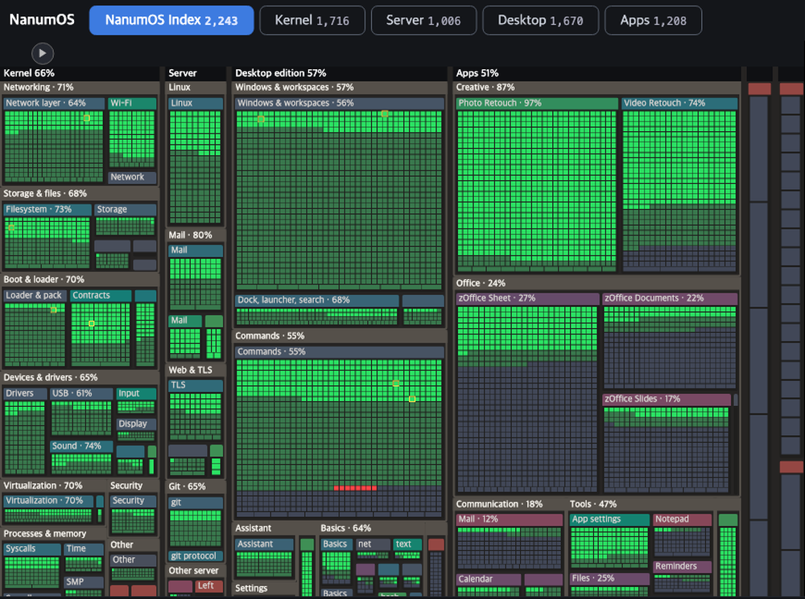

*The real record of one person building an operating system with dozens of AI coding models ([nanumos.com](https://nanumos.com)). One dot is one feature; bright green = done, dark green = in progress, slate = planned, red = being fixed. This is the project's public map, which uses the same ideas as DropViz.*


*20 seconds of the public replay (27 Oct to 14 Nov 2026): dots turn green as work is merged and checked. [MP4 version](docs/nanumos-timelapse.mp4). The public map starts its replay at that date.*

Everything runs on your computer; nothing is uploaded.

## Why it exists

DropViz was built as the control tower for a very large project: an operating system with a kernel, a desktop, a server and apps, developed by one person directing dozens of AI coding models working in parallel.
With that many workers you need one honest picture of what exists, what is in progress, what is actually done (merged and verified), where each model worked and what it cost in tokens.
Generating code was not the hard part; keeping the picture straight was. A model saying "done" is not evidence, so DropViz takes status only from git: merged into the main branch, with a verification record after the latest change.
Real-world case: [nanumos.com](https://nanumos.com)

## 5-minute start

**Ask your AI assistant: "install dropviz for this repo and connect it."** It can do it all by itself with the commands below
(the exact steps for assistants are in [INSTALL-FOR-AGENTS.md](INSTALL-FOR-AGENTS.md)).

Needs Python 3.10+ and git. No other dependencies (standard library only).

```
pipx install git+https://github.com/zeussoftware-kr/dropviz.git    # or: python3 -m pip install --user git+https://github.com/zeussoftware-kr/dropviz.git
dropviz --version                    # prints dropviz 0.1.0 or newer
dropviz connect                      # registers dropviz as an MCP server in the AI tools found here (backs up their config; --remove undoes it)
dropviz /path/to/your/repo           # one command: reads the repo, drafts areas from the folders, opens the map at http://127.0.0.1:8765/
dropviz https://github.com/<owner>/<repo>   # a public repo: history only (no files), kept in a cache folder
```

That is the whole first run. It never changes your repo: the draft lives in the git-ignored `.dropviz/` folder.
Nothing to set up, no AI tool needed (without one it is simply the history map of your repo). If the `dropviz` command is not found,
use `python3 -m dropviz ...` instead.

Try DropViz before pointing it at your own repo, with the invented example project (about 180 features, 450 commits, AI branches):

```
python3 examples/make_demo_repo.py /tmp/kestrel
dropviz /tmp/kestrel
```


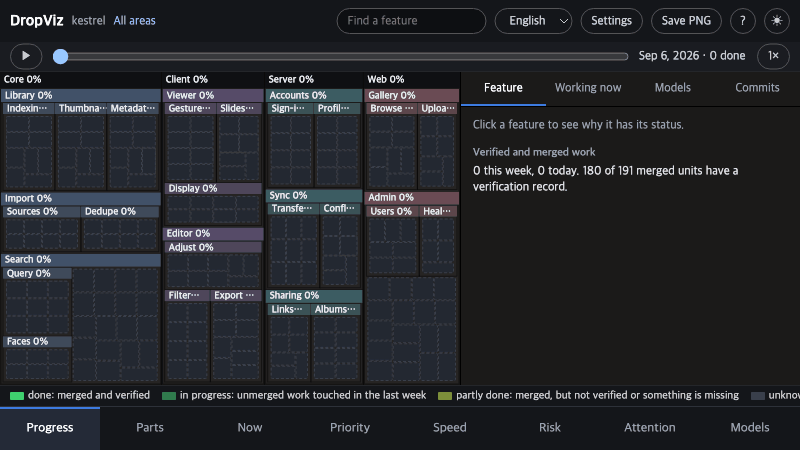

When you like it, give the map your own shape: open **Settings** on the page (or run `dropviz init` to write a
`dropviz.yaml` draft; it asks one question, "What are you building?"). The old file is always kept as a backup.

## What it reads

Only your repo's git history (commit messages included, for model names in trailers), an optional `dropviz.yaml`, and, if you want models and tokens, local records of AI tools (counts, timestamps, folder, branch, model name; never message text). It writes only to `.dropviz/` (git-ignored). The page is served on 127.0.0.1 only. Limits: by default status needs verification records (git notes or `ci-status.json`) to show anything as done (two opt-in git-only rules exist, see "The honesty rule"); token data exist only where local transcripts survive, while model names also come from commit trailers; GitHub checks are read only if you choose the `merged+ci` rule.

## What you see

- **Area / Feature / Card.** Three words, top to bottom (the map itself is a "treemap": rectangles whose size shows how much each part counts). An **area** is a block of the map and can hold features and
  other areas (the breadcrumb shows the depth, for example `Core > Library > Thumbnails`). A **feature** is one tile.
  A **card** is a piece of work on a feature; cards are listed when you open a feature (who did it, which model, state).
- **Zoom** into any area and back (click its title, `Esc` goes up). Search box, legend, works on a phone.
- **Eight views** of the same map (bottom bar): **Progress** (done share), **Parts** (what is where), **Now** (what is being worked on),
  **Priority** (your weights), **Speed** (verified work per week), **Risk** (red CI, idle branches and claims, merges nobody verified),
  **Attention** (most touched; counted on this computer only), **Models** (which model built what, from commit trailers). Every tile keeps a stripe in its real status colour in every view.
- **What sets the size**, your choice in Settings: number of features (planned ones included, so the whole map is the whole plan),
  a weight you give each area, or work so far (commits). The size rule never changes a status.
- **Planned** counts: say an area will end up with about 40 features and the missing ones show as grey "planned" placeholders. They are counted apart and are never "done".
- **Replay** (the play button): the history replays day by day, tiles lighting up in order, with a scrubber and 1x / 4x speed.
  `dropviz timelapse --out demo.gif` (or `.mp4`) renders it to a file; `--out map.png` saves the current map. Needs a headless browser (Playwright or Chrome) and ffmpeg for GIF/MP4. Files stay local.
- **Which model built what, from git alone:** the model names written in commit trailers (`Co-Authored-By`, `Assisted-By`, "Generated with"; names only, never e-mail addresses) give commits, changed lines and first/last date per model, per feature and per area, and colour the **Models** view. Shown as "from git trailers", not as a measurement; tokens stay "?" without local records. Details and the name table: [docs/TRAILERS.md](docs/TRAILERS.md).
- **Who built it:** human or AI tool (from `Co-Authored-By` trailers), the exact **model** when local transcripts exist
  (Claude Code, Codex, OpenCode records; counts only), a model filter on the map, and a **model ranking** panel
  (verified features per model, tokens per verified feature; counts only, with "not enough data" under 5 features).
  A model that cannot be determined is shown as "unknown model", never guessed.
- **Working now:** which tool and model is working on which feature, branch and machine, since when, last activity;
  "stalled" after 30 minutes quiet. Pulsing outline on the tiles; refreshes every 5 seconds. Only timestamps, folders, branches, model names and token counts are read, never message text.
- **Tokens:** a total counter on top (input, output, cache read, cache write; per tool and model; a chart over time). Days with no surviving transcript are a gap ("not recorded"), never zero. Counts only, never money.
- **Languages:** English and Korean, picked from the browser (page) or `LANG` / `--lang` (command line), switchable on the page. More languages = one more file in `src/dropviz/i18n/`.

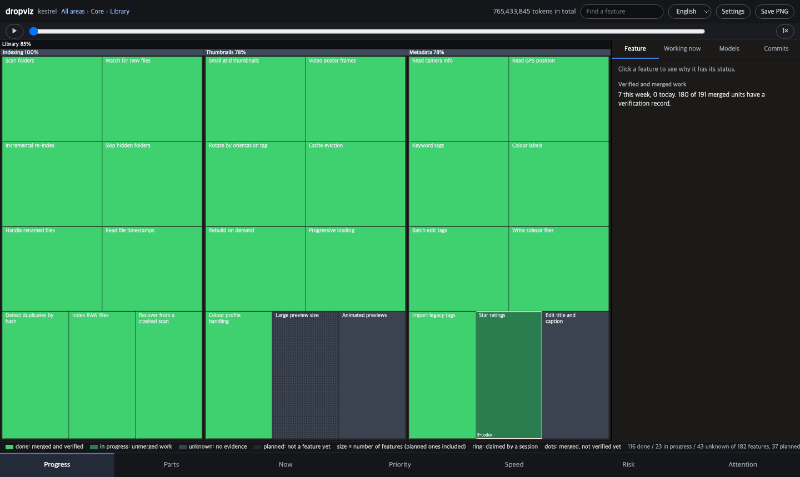

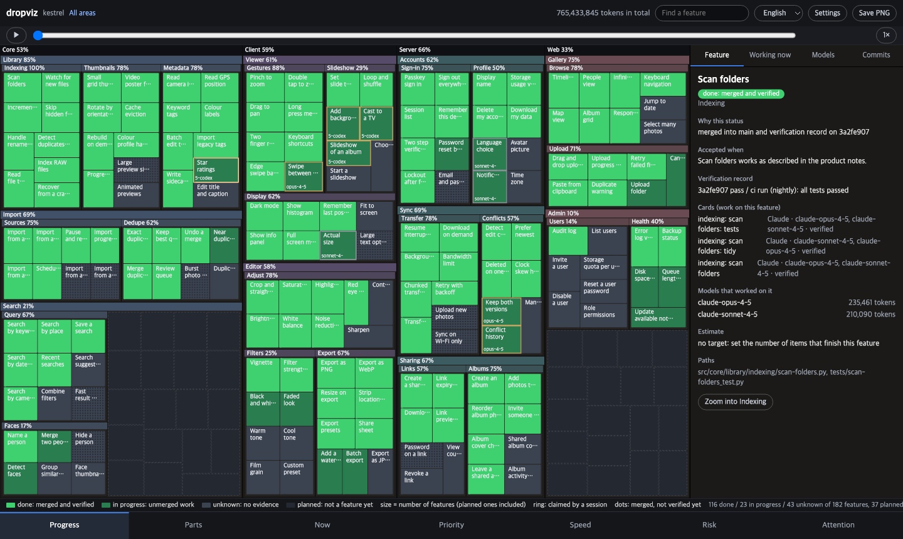

| Risk view | Working now | Models tab | Settings |
|---|---|---|---|
| 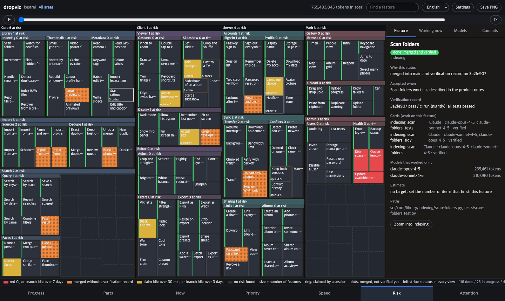 | 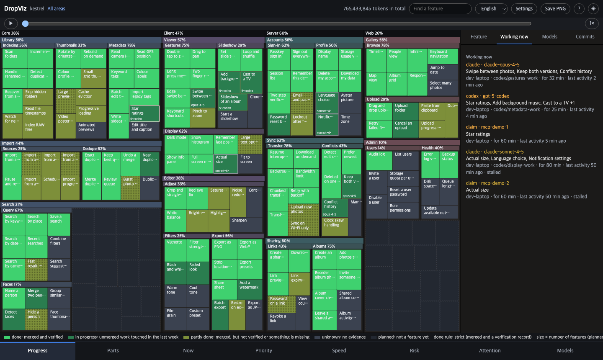 | 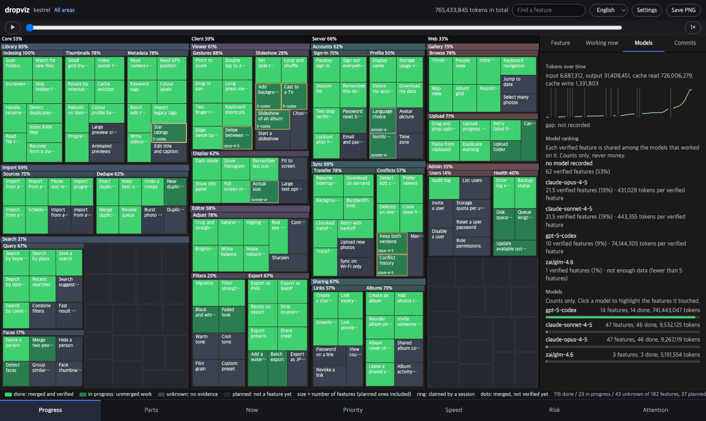 |  |

On a phone: 

## The honesty rule

- **done** = the feature's commits are merged into the default branch **and** a verification record exists at or after the
  latest merged change. Nothing else is "done".
- **in progress** = unmerged work exists on another branch.
- **unknown** (grey) = no evidence. Every feature starts here. Merged but not yet verified stays unknown (dotted tile).
- A claim or a report from an AI session **never** changes a status. Only git evidence does.
- The size rule, the view and the replay change sizes and colours, never what counts as done.
- Opt-in, for repos that keep no verification records: `--done merged` (merged, no newer unmerged work, no failing check) or `--done merged+ci` (also the commit's checks passed, read from `.dropviz/ci-status.json` or, for a GitHub `origin`, from the GitHub API: read only, public repos need no token, cached and capped). The legend always names the rule in use; the default stays strict. See [docs/TRAILERS.md](docs/TRAILERS.md).

A verification record is a git note your CI writes after the tests pass:

```
git notes --ref=dropviz-verify add -m "pass" <commit>
git notes --ref=dropviz-verify add -m "pass feature=login" <commit>   # scoped to one feature
```

Or a local `.dropviz/ci-status.json` with `{"<sha>": "pass" | "fail"}` (a `fail` marks the feature red in the Risk view).

## dropviz.yaml

```
name: "kestrel"
size_by: "features"            # features | weight | work
areas:
  - name: "Core"
  - name: "Library"
    parent: "Core"
    planned: 40                # about how many features it will have in the end
  - name: "Thumbnails"
    parent: "Library"
features:
  - id: "small-grid"
    name: "Small grid thumbnails"
    area: "Thumbnails"
    paths: ["src/core/library/thumbnails/small-grid.py"]
    accept: "A grid of small thumbnails loads without lag."
    target: 8                  # optional: items that finish it (used for the estimate)
```

Status is never written here; it is computed. Every default (colours, thresholds, view order, tool name patterns, folders)
lives in `src/dropviz/defaults.json`; a top-level key in `dropviz.yaml`, an environment variable `DROPVIZ_<NAME>` or the Settings panel overrides it.

## MCP: let Claude Code and Codex continue the work

MCP (Model Context Protocol) is the standard way an AI assistant calls tools on your computer; here it lets the assistant ask DropViz where the project stands.

`dropviz mcp` is a stdio MCP server. Tools: `status`, `next`, `claim`, `report`, `metrics`, `tokens`, `explain`, `configure`.
A new session asks "where are we and what is next", claims a feature (a second session is refused; claims expire after 2 hours idle),
and reports when it believes it is done (a claim only). `status` also returns who is working now, tokens per model and the model ranking.
`configure` lets your assistant set the areas for you ("split it into App, Server, Web"); the old `dropviz.yaml` is kept as a backup.

`dropviz connect` does the hookup for you (Claude Code, Codex, Gemini CLI, OpenCode: each through its own official command or config file, with a backup and `--remove` to undo).
By hand, Claude Code:

```
claude mcp add dropviz -- dropviz mcp
```

Codex, in `~/.codex/config.toml`:

```
[mcp_servers.dropviz]
command = "dropviz"
args = ["mcp"]
```

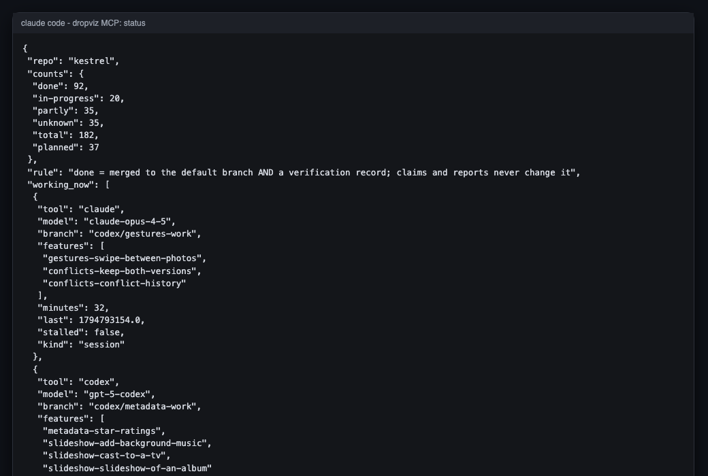

## Badge

`dropviz badge --out dropviz-badge.svg` writes a small static SVG ("verified features 116 · AI 64%", counts only; add `--tokens` for the token total)
and prints the Markdown to paste into your README.

## Other commands

```
dropviz metrics [repo] [--tokens]   # verified and merged work per day/week, tokens beside it, ETA per feature
dropviz tokens  [repo]              # tokens per commit and per model (counts only)
dropviz configure [repo] --areas "App,Server,Web" --size-by weight
```

`tokens` reads the local records of Claude Code, Codex and OpenCode (counts, timestamps, folder, branch, model; no message text) and attributes
them to the commit they went into. Records that fit no commit show up in an explicit *unattributed* bucket, never hidden.
If your tools work in short-lived worktrees, list them in `dropviz.yaml`: `worktree_roots: ["~/worktrees/*"]`.
To also watch other computers, list `remote_hosts: ["me@box"]` (off by default; only asks them whether a transcript changed recently, over read-only ssh).

## Example: a public repo built with AI coding agents

Try it on a repo you did not write. [storytold/photocraft](https://github.com/storytold/photocraft) is a public repository (Apache-2.0) whose commit messages carry AI co-author trailers (6,534 of its 13,114 commits, counted with `git log`). Shown only as a worked example.

```
pipx install git+https://github.com/zeussoftware-kr/dropviz.git
dropviz https://github.com/storytold/photocraft      # history only, kept in a cache folder; about a minute here
```

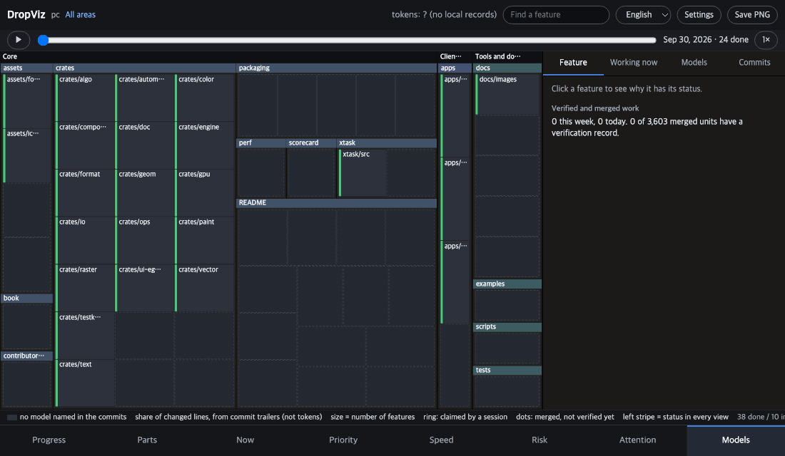

*12 seconds, 46 days of history (Models view). A feature is drawn only from the day of its first commit; before that its slot is empty. Colour bands = each model's share of the changed lines, read from the commit trailers (not measured; tokens are unknown). [MP4](docs/example-photocraft.mp4).*

The same repo in four views (each answers one question):

| | |
|---|---|
| 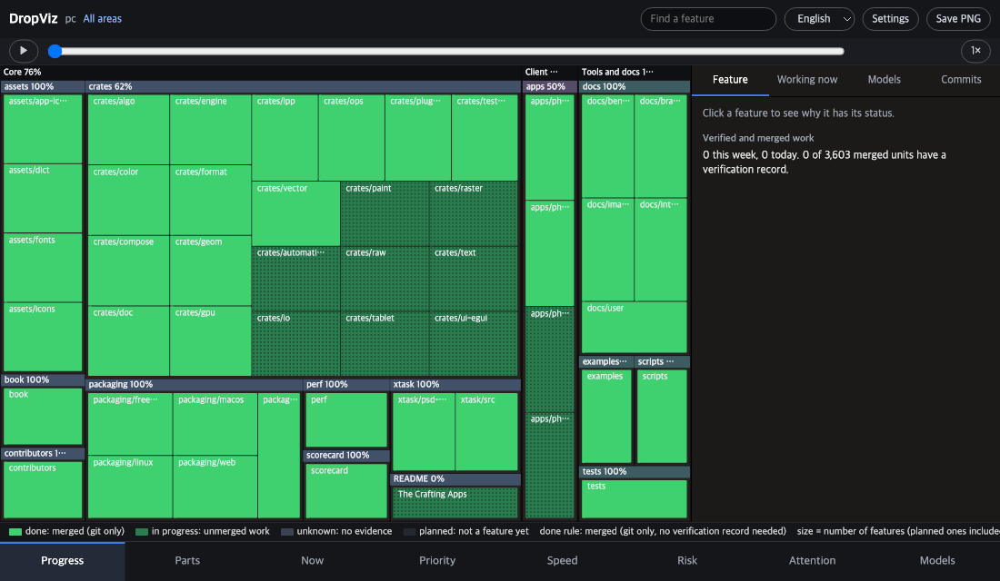 | 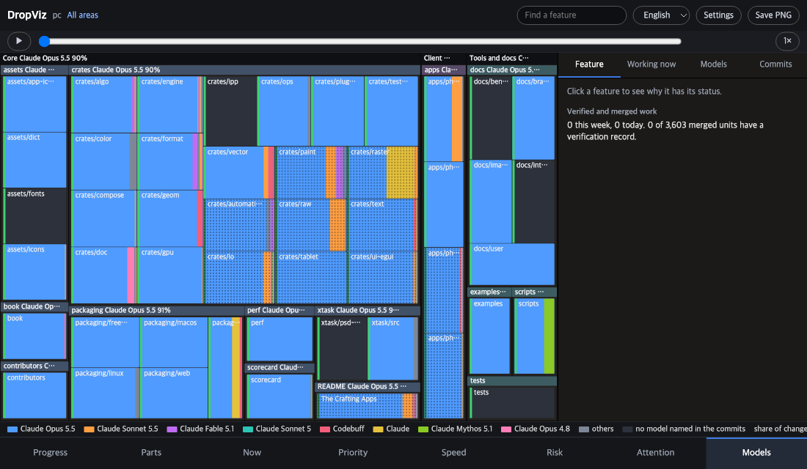 |
| **Progress: where are we?** Bright green = merged (this example uses `--done merged`, because the repo keeps no verification records; the legend says so). Dotted = unmerged work exists. | **Models: which model built what?** Bands = share of changed lines per model, from commit trailers. Grey = no model named in the commits. |
| 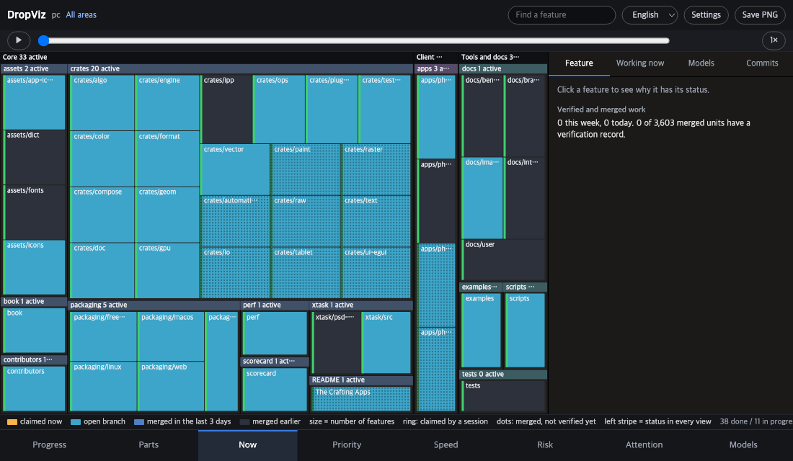 | 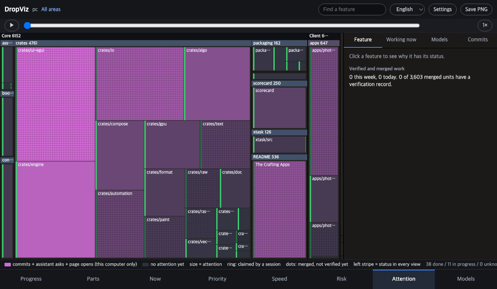 |
| **Now: where is work open?** Blue = work on a branch that is not merged yet. | **Attention: where did the effort go?** Size and colour follow how much each folder was touched. |

- DropViz drafted 49 features from the folders. README headings are not drafted as features unless one names a code folder (then it gets that folder's paths); sections like Security, Downloads or License are never drafted.
- 5,056 of the 13,115 commits on the default branch name a model in a trailer (21 different names). One model, `Claude Opus 5.5`, accounts for 90% of the changed lines and 4,348 commits; the rest is spread over smaller shares. Counting rules and the name table: [docs/TRAILERS.md](docs/TRAILERS.md). These are names written into commits, not measurements.
- Tokens show as "?" because token counts come only from local AI-tool records on your computer, and a repo you only cloned has none.
- With the default strict rule no tile is **done**: "done" needs a verification record (a git note written by CI, see "The honesty rule"), and this repo has none. Run `dropviz <repo> --done merged` for the git-only rule shown above.
- The Speed view needs verification records too, so it is not shown here (every tile would read 0 per week).
- Parsing the trailers of this 13,115-commit history takes about 5 seconds (one `git log` call).
- It also ran on [openclaw/openclaw](https://github.com/openclaw/openclaw) (MIT; 2,794 AI co-author trailers in 128,567 commits), but its history is too large to replay in minutes here, so no replay is shown.

## Status of this project

Works now: local git reader, the area map with seven views, size rules, settings with backup, replay, working-now layer,
models and tokens, `init` / `serve` / `mcp` / `tokens` / `metrics` / `timelapse` / `configure` / `badge`, `dropviz <path-or-url>`.
Not built yet: GitHub / GitLab connections (checks, pull requests), AI-tool hooks, a first-pass rate per model (needs red-gate history),
publishing the map as a static site (`dropviz publish`).

Next: **publish** (a self-contained static site of your map, with a GitHub Pages workflow and an Atom feed of newly verified
features; you choose what is public, tokens and models hidden by default) and **reference list import**: bring your own checklist of the features,
menus and shortcuts of the product you aim to match (CSV/TSV), each row becomes a planned tile with same / different / missing and test evidence,
so the map shows "% like the target". DropViz ships no third-party product lists.

Tested on macOS and Linux (CI also runs Windows, Python 3.10 and 3.12; see the Actions tab for the current state).
The treemap draws SVG with our own code (no CDN, no external fonts); the first map of a repo needs only git.

```
python3 -m unittest discover -s tests
```

License: Apache-2.0 (see LICENSE, NOTICE). Issues are welcome, code contributions are not accepted yet (see CONTRIBUTING.md).
Security reports: SECURITY.md. Made by Zeus Software (zeus.kim).

---

# DropViz (한국어)

**DropViz 는 AI 코딩 모델 수십 개가 함께 만드는 아주 큰 프로젝트의 관제탑입니다. 무엇이 있고, 무엇을 만드는 중이고, 무엇이 진짜 끝났는지를 프로젝트 자신의 git 기록을 근거로 지도 한 장에 보여 줍니다.**

**이럴 때 쓰세요:**
- 한 저장소에서 AI 코딩 비서 여러 개가 일하는데, 무엇이 정말 끝났는지 놓치게 될 때
- 누가 그렇다고 말한 것이 아니라, 지금 어디서 일하고 있고 무엇이 병합·검증되었는지 보고 싶을 때
- 비서가 "지금 어디까지 했고, 다음은 뭐야?"에 저장소 자체를 보고 답하게 하고 싶을 때


*AI 코딩 모델 수십 개와 한 사람이 운영체제를 만든 진짜 기록입니다([nanumos.com](https://nanumos.com)). 점 하나가 기능 하나이고, 밝은 초록 = 끝남, 짙은 초록 = 작업 중, 회색 = 계획, 빨강 = 고치는 중입니다. 이 프로젝트의 공개 지도이며 DropViz 와 같은 생각으로 만들었습니다.*


*공개 다시 보기 20초(2026-10-27 ~ 11-14): 일이 병합·확인될 때마다 점이 초록으로 바뀝니다. [MP4 판](docs/nanumos-timelapse.mp4). 공개 지도는 이 날짜부터 다시 보기를 시작합니다.*

모든 것은 내 컴퓨터에서만 돌아가고 밖으로 올리지 않습니다.

## 왜 만들었나

DropViz 는 아주 큰 프로젝트(커널·데스크톱·서버·앱을 가진 운영체제)를 한 사람이 수십 개의 AI 코딩 모델을 동시에 지휘하며 개발할 때 쓰는 관제탑으로 만들었습니다.
일꾼이 그만큼 많으면 무엇이 있는지, 무엇이 진행 중인지, 무엇이 정말 끝났는지(병합되고 검증됨), 어느 모델이 어디서 일했고 토큰이 얼마나 들었는지를 한 장의 정직한 그림으로 봐야 합니다.
코드를 만드는 것은 어려운 부분이 아니었고, 그림을 바르게 유지하는 것이 어려웠습니다. 모델이 "끝났다"고 말한 것은 근거가 아니므로, DropViz 는 상태를 git 에서만 가져옵니다: 기본 가지에 병합되었고 마지막 변경 뒤에 검증 기록이 있을 때만.
실제 사례: [nanumos.com](https://nanumos.com)

## 5분 시작

AI 비서에게 이렇게 말하세요: **"이 레포 깔아 줘. dropviz 설치하고 연결해 줘."** 비서가 아래 명령으로 스스로 할 수 있습니다(비서용 정확한 순서: [INSTALL-FOR-AGENTS.md](INSTALL-FOR-AGENTS.md)).
파이썬 3.10 이상과 git 만 있으면 됩니다(표준 라이브러리만 사용).

```
pipx install git+https://github.com/zeussoftware-kr/dropviz.git
dropviz connect                              # 여기 있는 AI 도구에 MCP 서버로 등록(설정 백업, --remove 로 되돌림)
dropviz /내/저장소                            # 한 줄: 저장소를 읽고, 폴더로 영역 초안을 만들고, 지도를 엽니다
dropviz https://github.com/<소유자>/<저장소>    # 공개 저장소: 역사만 받아 캐시 폴더에 둡니다(파일 없이)
```

내 저장소는 바뀌지 않습니다. 초안은 git 이 무시하는 `.dropviz/` 폴더에만 둡니다. 설정도, AI 도구도 필요 없습니다(AI 를 안 썼다면 그냥 역사 지도입니다).

먼저 가짜 예제로 보려면:

```
python3 examples/make_demo_repo.py /tmp/kestrel
dropviz /tmp/kestrel
```

마음에 들면 화면의 **설정**에서 내 모양으로 바꾸세요(또는 `dropviz init`: "무엇을 만들고 있나요?" 한 가지만 묻고 `dropviz.yaml` 초안을 씁니다). 이전 파일은 늘 백업으로 남습니다.

## 화면

- **영역 / 기능 / 카드.** 위에서 아래까지 낱말은 셋입니다. **영역**은 지도의 한 덩어리이고 기능과 다른 영역을 담을 수 있습니다(깊이는 `Core > Library > Thumbnails` 처럼 경로로 보임).
  **기능**은 타일 하나, **카드**는 기능 안의 일 하나입니다(기능을 열면 누가, 어느 모델이, 어떤 상태인지 나옵니다).
- 영역을 눌러 안으로 들어가고(`Esc` 로 나옴), 찾기·범례가 있고, 폰에서도 됩니다.
- 같은 지도를 보는 **여덟 화면**(아래 줄): 진척도 · 부품 · 지금 · 중요도 · 속도 · 위험 · 관심 · 모델(커밋 꼬리말로 보는 「누가 무엇을 만들었나」). 어느 화면에서도 타일 왼쪽 띠는 진짜 상태 색입니다.
- **크기 기준**은 설정에서 고릅니다: 기능 수(계획한 것 포함) · 내가 정한 가중치 · 지금까지 한 일(커밋). 크기 기준은 상태를 바꾸지 않습니다.
- **계획** 개수: 영역이 끝나면 기능이 대략 40개라고 적으면 모자란 만큼 회색 "계획" 칸이 보입니다. 따로 세고, 절대 "됨"이 아닙니다.
- **다시 보기**(재생 단추): 역사를 하루씩 돌려 타일이 차례로 켜집니다. `dropviz timelapse --out demo.gif`(또는 `.mp4`, `.png`)로 파일을 만듭니다. 파일은 내 컴퓨터에만 남습니다.
- **git 만으로 보는 모델:** 커밋 꼬리말(`Co-Authored-By`, `Assisted-By`, "Generated with")에 적힌 모델 이름(이름만, 이메일은 버림)으로 모델별 커밋·바뀐 줄·처음/마지막 날짜를 기능·영역마다 보이고 **모델** 화면을 칠합니다. 「git 꼬리말에서」라고 표시하며 측정값이 아닙니다. 토큰은 로컬 기록이 없으면 `?`. 자세히: [docs/TRAILERS.md](docs/TRAILERS.md).
- **누가 만들었나**: 사람인지 AI 도구인지(`Co-Authored-By`), 내 컴퓨터에 기록이 있으면 정확한 **모델**, 모델 필터, **모델 순위**(수만 셈, 5개 미만이면 "자료 부족").
  알 수 없으면 "모델 모름"으로 둡니다.
- **지금 일하는 중**: 어떤 도구·모델이 어느 기능·가지·컴퓨터에서 언제부터 일하는지(30분 넘게 조용하면 "멈춤"). 5초마다 새로 고칩니다. 대화 내용은 읽지 않습니다.
- **토큰**: 맨 위 합계(입력·출력·캐시, 도구·모델별, 시간 그래프). 기록이 없는 날은 0 이 아니라 빈 칸입니다. 수만 셉니다.
- **언어**: 영어·한국어. 브라우저/`LANG`/`--lang` 로 고르고 화면에서 바로 바꿉니다. 언어를 더하려면 `src/dropviz/i18n/` 에 파일 하나만 더하면 됩니다.

## 정직 규칙

- **done(됨)** = 그 기능의 커밋이 기본 브랜치에 병합되었고, 가장 최근 병합 변경 이후에 검증 기록이 있을 때만.
- **in-progress** = 다른 가지에 병합 안 된 작업이 있음. **unknown(회색)** = 근거 없음(병합됐지만 검증 전이면 점무늬).
- AI 세션의 「맡음」·「했음」 보고는 상태를 **바꾸지 않습니다**. git 근거만 바꿉니다. 크기 기준·화면·다시 보기도 상태를 바꾸지 않습니다.
- 선택 사항(검증 기록을 두지 않는 저장소용): `--done merged`(병합, 더 새로운 미병합 작업 없음, 실패한 검사 없음) 또는 `--done merged+ci`(그 커밋의 검사 통과까지; `.dropviz/ci-status.json` 이나 GitHub `origin` 이면 GitHub API 를 읽기만, 공개 저장소는 토큰 불필요, 저장·횟수 제한). 범례에 쓰는 규칙이 늘 적히며 기본은 엄격 규칙입니다. [docs/TRAILERS.md](docs/TRAILERS.md).

검증 기록은 시험이 통과한 뒤 CI 가 적는 git note 입니다:

```
git notes --ref=dropviz-verify add -m "pass" <커밋>
```

## MCP 로 Claude Code·Codex 가 이어서 개발

`dropviz mcp` 는 stdio MCP 서버입니다(도구: `status` `next` `claim` `report` `metrics` `tokens` `explain` `configure`). `dropviz connect` 가 연결을 대신 해 줍니다. `configure` 로 비서에게
"앱, 서버, 웹으로 나눠 줘"라고 시킬 수 있습니다(이전 `dropviz.yaml` 은 백업으로 남음). 설정은 위 영어 절의 `claude mcp add dropviz -- dropviz mcp` 와 Codex `config.toml` 을 그대로 쓰세요.

## 배지

`dropviz badge --out dropviz-badge.svg` 가 작은 SVG 배지("검증된 기능 116개 · AI 64%", 수만)를 만들고 README 에 붙일 Markdown 을 알려 줍니다.

## 현재 상태

지금 되는 것: 로컬 git 읽기, 일곱 화면 영역 지도, 크기 기준, 백업이 남는 설정, 다시 보기, 지금 일하는 중, 모델·토큰, `dropviz <경로 또는 URL>`, `dropviz connect`.
아직 없는 것: GitHub·GitLab 연결, AI 도구 훅, 모델별 첫 통과율, 지도를 정적 사이트로 올리기(`dropviz publish`).
다음: **publish**(정적 사이트 + GitHub Pages 설정 + 새로 검증된 기능 피드)와 **참조 목록 가져오기**(목표로 삼는 제품의 기능·메뉴·단축키 목록을 내 CSV 로 가져와
같음/다름/없음과 시험 근거를 타일로 보여 줌). dropviz 는 남의 제품 목록을 싣지 않습니다.

macOS·Linux 에서 시험했습니다(CI 는 Windows 도 돌리며 현재 상태는 Actions 탭에서 볼 수 있습니다). 이슈는 환영하고, 코드 기여는 아직 받지 않습니다(CONTRIBUTING.md). 보안 제보는 SECURITY.md. 라이선스 Apache-2.0. 만든 곳: 제우스소프트웨어(zeus.kim).

## 예제: AI 코딩 에이전트로 만든 공개 저장소

내가 쓰지 않은 저장소에 돌려 보세요. [storytold/photocraft](https://github.com/storytold/photocraft) 는 공개 저장소(Apache-2.0)이고 커밋 메시지에 AI 공동 작성자 표시가 있습니다(13,114개 중 6,534개, `git log` 로 센 값). 작동 예시일 뿐입니다.

```
pipx install git+https://github.com/zeussoftware-kr/dropviz.git
dropviz https://github.com/storytold/photocraft      # 역사만 받아 캐시 폴더에 둠, 여기서는 약 1분
```


*12초, 46일치 역사(모델 화면). 기능은 첫 커밋 날부터 그려지고 그 전에는 빈 칸입니다. 색 띠 = 모델별로 바꾼 줄의 비율, 커밋 꼬리말에서 읽은 값(측정값 아님, 토큰은 모름). [MP4](docs/example-photocraft.mp4).*

같은 저장소를 네 화면으로(화면마다 묻는 것이 하나씩):

| | |
|---|---|
|  |  |
| **진행: 어디까지 왔나?** 밝은 초록 = 병합됨(이 예시는 검증 기록이 없는 저장소라 `--done merged` 를 썼고 범례에 적혀 있음). 점무늬 = 병합 안 된 작업 있음. | **모델: 어느 모델이 무엇을 만들었나?** 띠 = 모델별 바뀐 줄의 비율(커밋 꼬리말). 회색 = 커밋에 모델 이름 없음. |
|  |  |
| **지금: 어디에 열린 작업이 있나?** 파랑 = 아직 병합 안 된 가지의 작업. | **관심: 힘이 어디에 들어갔나?** 크기와 색이 폴더를 얼마나 만졌는지를 따릅니다. |

- 폴더로 기능 49개 초안을 만들었습니다. README 제목은 코드 폴더 이름을 말할 때만(그 폴더 경로를 붙여) 기능이 되고, 보안·다운로드·라이선스 같은 절은 기능으로 만들지 않습니다.
- 기본 브랜치 커밋 13,115개 중 5,056개가 꼬리말에 모델 이름을 적었습니다(서로 다른 이름 21개). `Claude Opus 5.5` 하나가 바뀐 줄의 90%, 커밋 4,348개이고 나머지는 작은 비율로 나뉩니다. 세는 법과 이름 표: [docs/TRAILERS.md](docs/TRAILERS.md). 커밋에 적힌 이름이며 측정값이 아닙니다.
- 토큰은 "?" 입니다. 토큰은 내 컴퓨터의 AI 도구 기록에서만 읽는데 내려받기만 한 저장소에는 없기 때문입니다.
- 기본 엄격 규칙에서는 **됨**인 타일이 없습니다. "됨"에는 검증 기록(CI 가 적는 git note, 「정직 규칙」 참고)이 필요한데 이 저장소엔 없습니다. 위 화면의 git 만 쓰는 규칙은 `dropviz <저장소> --done merged` 입니다.
- 속도 화면도 검증 기록이 필요해서(모든 타일이 주당 0) 여기에는 싣지 않았습니다.
- 커밋 13,115개짜리 역사의 꼬리말을 읽는 데 약 5초 걸립니다(`git log` 한 번).
- [openclaw/openclaw](https://github.com/openclaw/openclaw) (MIT, 커밋 128,567개 중 AI 공동 작성자 표시 2,794개)에도 돌려 보았지만 역사가 너무 커서 몇 분 안에 다시 보기를 만들 수 없어 영상은 싣지 않았습니다.
